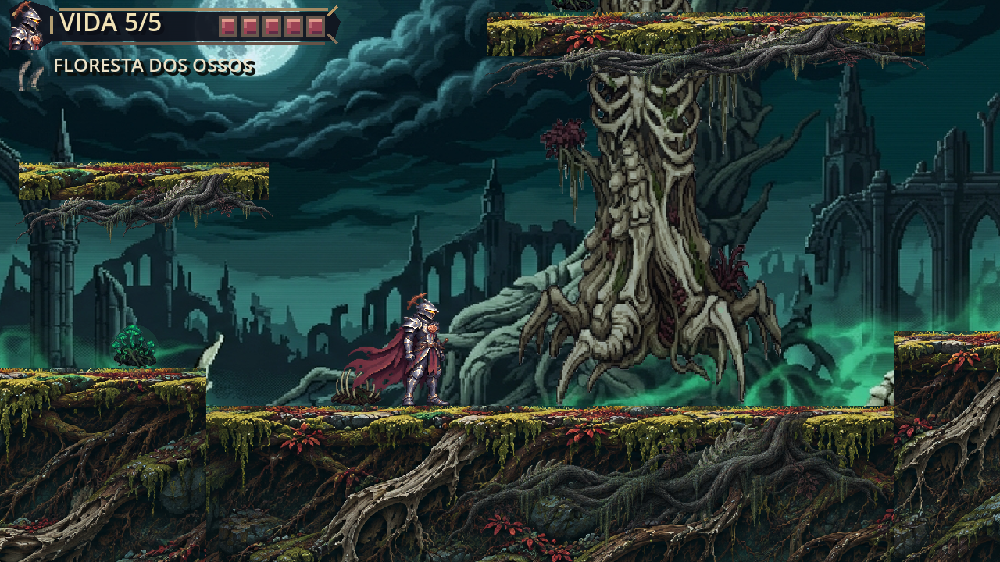
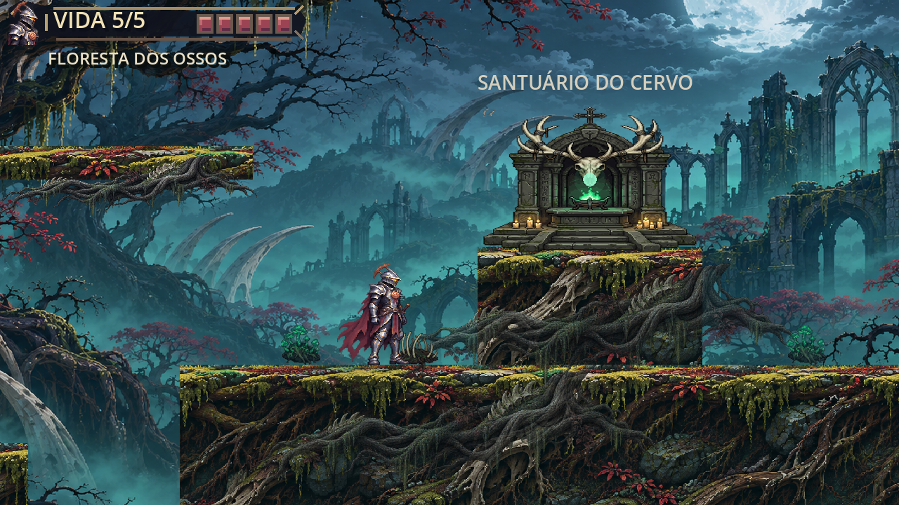

# M6-A — recuperação artística dos dois pilotos

**Estado: implementação local para avaliação visual, sem homologação.** A revisão funcional passou nos ensaios abaixo. As imagens não substituem playtest, nem demonstram ausência de todas as emendas durante toda a movimentação.

## Diagnóstico e preservação

O FIX03 usava o mesmo trecho do atlas repetido em blocos de 48/64 px, com origem de recorte reiniciada por módulo e uma linha clara em cada topo; isso produzia emendas e repetição. Um recorte do atlas de adereços incluía objetos vizinhos e aparecia suspenso ou cortado. O título e subtítulo ficavam permanentes sobre a exploração.

Um backup dos recursos `assets/art/m6a`, scripts e cenas da Floresta e capturas `m6a_fix03` anteriores está em `C:/Users/ovohe/.codex/visualizations/2026/11/03/01a19f0a-ee96-7412-bd99-7c6152fadd40/m6a-art-recovery-backup-20261106`, com 30 arquivos e `sha256.csv`. Os recursos originais não foram substituídos. As alterações preexistentes do M5-H, as cenas e a geometria funcional da Floresta foram preservadas.

## Construção visual

- `forest_ground_codex.png`: textura original independente de solo, raízes, pedra e musgo. O recorte é ancorado em coordenadas do mundo, com topo alinhado aos retângulos existentes e período de 384 unidades; não reinicia a cada colisor. Um preenchimento escuro cobre profundidades além da imagem. A repetição periódica e quinas verticais ainda podem ser percebidas em algumas composições; não se afirma encaixe perfeito de todos os casos.
- `forest_root_codex.png`: raiz transparente independente aplicada como saia de ramos e ligação sob troncos e altar. É decoração, sem colisões.
- `forest_bosque_codex.png`: novo fundo distante independente para o setor 2, com lua, árvores, ruínas e névoa. O fundo original do setor 1 e o santuário isolado foram preservados. A referência enviada foi usada para atmosfera, não como textura recortada do jogo.
- `forest_art.gd`: remove o trilho claro e recortes repetitivos, fixa bases dos troncos no terreno, remove a composição problemática de costelas recortadas e mantém arcos ósseos na paisagem distante. Continuidade e parallax ainda precisam de avaliação em movimento. O filtro permanece Nearest.
- `forest_pilots.tscn`: título menor e subtítulo de piloto oculto, sem alteração do HUD canônico de vida. Não houve mudanças em física, colisores, geometria, dash, combate, checkpoints, progressão ou saves.

Os três PNGs foram gerados pelo recurso integrado de geração de imagens. Pedidos usados, resumidamente: (1) corte horizontal de solo gótico com topo musgoso, pedras e raízes fossilizadas, sem personagens ou interface; (2) raiz longa isolada com alfa, ossos discretos e líquen; (3) floresta gótica lunar distante com árvores fósseis, ruínas e névoa, sem plataformas, santuário, personagens ou interface. A imagem conceitual aprovada foi referência de atmosfera para (1) e (3).

## Comparação FIX03 / reconstrução

As duas colunas usam capturas reais dos respectivos estados; os enquadramentos são próximos, não idênticos.

| Antes — FIX03 | Depois — recuperação |
| --- | --- |
|  |  |
|  |  |

Capturas adicionais: [entrada](evidencias/m6a_codex_recovery/setor1_01_inicio.png), [plataformas elevadas](evidencias/m6a_codex_recovery/setor1_05_plataformas_altas.png), [abismo com dash](evidencias/m6a_codex_recovery/setor2_02_abismo_travessia.png), [bosque](evidencias/m6a_codex_recovery/setor2_03_bosque_meio.png), [árvore](evidencias/m6a_codex_recovery/setor2_04_arvore_monumental.png) e [santuário](evidencias/m6a_codex_recovery/setor2_05_santuario_cervo.png). Foram criadas 12 capturas gráficas a 1280×720; o roteiro posiciona Aren para compor os pontos, e a foto de dash usa o controlador existente. Elas não representam, sozinhas, uma travessia contínua.

## Testes desta rodada

Godot 4.7.2, cópia isolada do HEAD com as alterações locais relevantes sobrepostas, `project.godot` do HEAD e perfis `APPDATA` separados. Importação e execução gráfica concluídas; ocorreu o diagnóstico ambiental já conhecido de certificados. O primeiro ensaio gráfico teve erro de tipo na lista de raízes; foi corrigido e o ensaio final não mostrou erro de script.

| Ensaio | Resultado |
| --- | --- |
| `m6_a_pilot_test.gd` | 24/24; parte dos cenários usa posicionamento ou chamadas diretas de teste. |
| `m6_a_codex_recovery_physics.gd` | 6/6; caminhada nas transições nos dois sentidos e Shift real seguido de salto atravessando o vão de 60 px nos dois sentidos. |
| `combat_test.gd` | 36/36. |
| `m5_h_aerial_test.gd` | 16/16. |
| `dash_vfx_test.gd` | 47/47. |
| `recompensa_guardiao_test.gd` | 33/33. |
| `smoke_test.gd` e `survival_test.gd` | Movimento sem falhas e 59/59 respectivamente, antes da última remoção exclusivamente visual de adereços. |

Medição gráfica curta `m6_a_codex_recovery_performance.gd`: janela 1280×720, OpenGL Compatibility, RTX 2060 SUPER, 300 quadros/5 s por setor. S1: 60,00 FPS, média 16,667 ms, p95 17,018 ms, máximo 18,240 ms; S2: 60,00 FPS, média 16,667 ms, p95 16,991 ms, máximo 17,238 ms. É amostra breve com movimento automatizado, não benchmark de 4K, de longa duração ou prova de ausência de jitter.

## Avaliação pendente

O responsável deve executar `scenes/forest/forest_pilots.tscn` no editor e avaliar entrada, tronco, plataformas, travessia, santuário e retorno com Aren em movimento. Inspecionar particularmente as bordas dos patamares e o padrão que volta após 384 px; o terreno ainda usa recorte retangular para respeitar os colisores, apesar das raízes sobrepostas. A qualidade e integração artística dependem de sua aprovação. Não foi criado setor adicional ou boss.

Branch `main`, HEAD `2ac02cf0344b5fa5fc447b301cfdd8bae397be43`, sem staging, commit, push ou deploy. Os 15 protegidos mantiveram os hashes. **O save pessoal estava presente no início com SHA-256 `DFCAEFA0CE82A0E25852789596CDA63F394A85C05F8511D3D7D6A7D575DA2293`, mas o arquivo não estava presente na conferência final; causa não determinada.** Os testes foram iniciados com perfis `APPDATA` isolados. Foram encontradas cópias em perfis de teste com o mesmo hash inicial; nenhuma foi restaurada ou sobrescrita. Exemplo de cópia: `C:/Users/ovohe/.codex/visualizations/2026/11/03/01a19f0a-ee96-7412-bd99-7c6152fadd40/m5-candidate-profile-m5_g_fix05_live_hud_test/Godot/app_userdata/Cinzas do Juramento/cinzas_abbey_progress_v1.json`. O M5-H permanece separado desta entrega e não foi incluído em manifesto novo.

`git diff --check` assinala espaços finais em linhas do arquivo local `scripts/player/knight_visual.gd`, fora da reconstrução M6-A. Não foi feita limpeza indiscriminada dessas alterações preexistentes.
