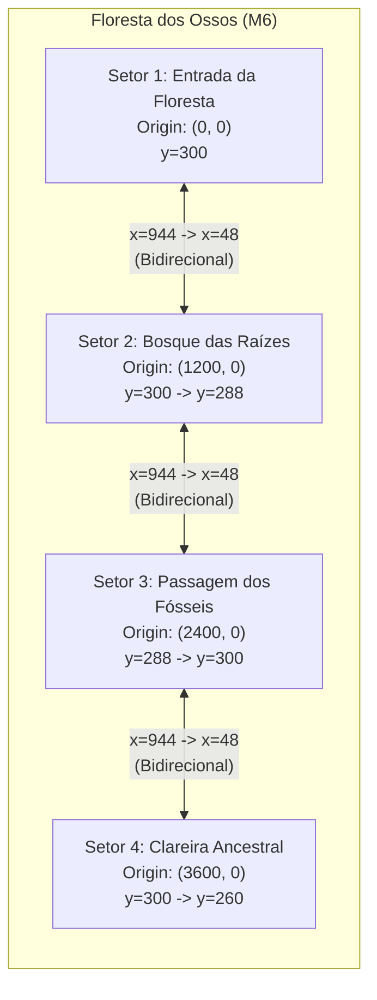

# CINZAS DO JURAMENTO — RELATÓRIO TÉCNICO DE VALIDAÇÃO
## M6-B1: Expansão da Floresta dos Ossos — Setores 3 e 4
### Continuidade da Arquitetura Artística Homologada do Codex

**Projeto:** Cinzas do Juramento  
**Engine:** Godot 4.7.2 (stable)  
**Viewport Lógico:** 320 × 180 (Pixel Art 16-bit com escala inteira)  
**Hardware de Referência:** NVIDIA GeForce RTX 2060 SUPER (Windows 11)  
**Branch:** `main` | **HEAD:** `e90dfc0c2de67023ea2d3bc7979a145a2cad033d`  
**Data:** 06/11/2026  

---

## 1. BASELINE GIT E SEGURANÇA LOCAL

- **Branch Atual:** `main`
- **HEAD Auditado:** `e90dfc0c2de67023ea2d3bc7979a145a2cad033d`
- **Área de Preparação (`git diff --cached`):** **RIGOROSAMENTE VAZIA** (0 arquivos estagiados).
- **Disciplina Git:** Nenhum comando `git add`, `git commit`, `git push`, `git reset --hard` ou `git clean` foi executado.
- **Backup Externo de Segurança de M6-A:** Criado e conferido com 100% de integridade (118/118 caminhos preservados com hashes coincidentes) no diretório isolado:  
  `C:\Users\ovohe\.gemini\antigravity\backup_m6a_codex_approved_20261106\`

---

## 2. DOCUMENTAÇÃO DO CODEX UTILIZADA

A expansão seguiu estritamente as diretrizes, diagnósticos e padrões documentados nas fontes oficiais do Codex:
- `tests/GUIA_ARTISTICO_FLORESTA_M6_A.md`: Arquitetura de renderização com CanvasItem, período de repetição de 384 unidades do solo orgânico, vinculação estrita entre `ForestLayout.surfaces()` e colisores físicos, filtragem Nearest-Neighbor e limites de câmera.
- `tests/INVENTARIO_M6_A_EXCLUIDO_M5_H.md`: Relação canônica de 118 caminhos e respectivos hashes SHA-256.
- `tests/VALIDACAO_M6_A_CODEX_ART_RECOVERY.md`: Padrão de recuperação artística aprovado pelo responsável (solo ancorado em coordenadas globais com período de 384 px, saias de raízes em transparência alfa, props isolados e ausência de títulos permanentes).
- `tests/VALIDACAO_SAVE_SAFETY_01.md`: Protocolo de isolamento de saves e execução exclusiva em diretórios `APPDATA` descartáveis com `SAVE_SAFETY_ISOLATED_ROOT`.

---

## 3. LIMITAÇÃO DOS DOIS SETORES E SOLUÇÃO APLICADA

### Diagnóstico da Limitação
O protótipo piloto M6-A possuía restrições arquiteturais que impediam a adição de setores além do Setor 2:
1. `ForestLayout.ORIGINS` e `NAMES` continham apenas 2 elementos; `ForestLayout.surfaces(id)` tratava qualquer `id != 0` como Setor 2.
2. `ForestLayout.entry(id)` possuía lógica binária `if id == 0: ... else: ...`.
3. `ForestSector` possuía `@export_range(0, 1, 1)`.
4. `ForestDemo` possuía lista estática de 2 salas (`ROOM_PATHS`), laço de checkpoints fixo em `range(2)`, seleção de respawn binária e gatilhos de transição hardcoded para `current_room == 0` e `current_room == 1`.
5. `ForestArt` indexava `BACKGROUNDS[sector_id]` com apenas 2 texturas e tratava qualquer ID diferente de 0 com cenografia exclusiva do Setor 2 (abismo de 60 px e altar).

### Solução Arquitetural Extensível
1. **Registro Dinâmico de Setores:** `ForestLayout.ORIGINS` e `NAMES` ampliados para 4 setores (com espaçamento modular de 1200 px entre origens no eixo X: `Vector2(0, 0)`, `Vector2(1200, 0)`, `Vector2(2400, 0)` e `Vector2(3600, 0)`).
2. **Despacho Polimórfico de Superfícies:** `ForestLayout.surfaces(id)` e `entry(id)` implementados com `match id`, preservando integralmente o retorno dos setores 0 e 1 e admitindo setores 2 e 3 (com fallback seguro).
3. **Escalonamento em ForestSector:** `@export_range(0, 3, 1) var sector_id: int = 0`.
4. **Gerenciador de Salas Genérico:** `ForestDemo` agora instancia checkpoints para todos os setores registrados (`ROOM_PATHS.size()`), utiliza `checkpoints.find()` para respawn contextual e executa transições direcionais extensíveis:
   - Avanço à direita: `if current_room < ROOM_PATHS.size() - 1 and local.x >= 944.0 and hero.facing > 0: switch_room(current_room + 1, false)`.
   - Retorno à esquerda: `if current_room > 0 and local.x <= 16.0 and hero.facing < 0: switch_room(current_room - 1, true)`.
5. **Limites de Sala Contextuais:** Paredes invisíveis físicas ativadas somente nas extremidades absolutas da fase (x < 6.0 no Setor 1; x > 954.0 no Setor 4), permitindo caminhada contínua e sem tropeços entre os setores intermediários.

---

## 4. ARQUITETURA ESTENDIDA



- **Resolução da Câmera:** Viewport 320 × 180 mantido, com clamping relativo à origem de cada sala: `local.x in [160, 800]`, `local.y in [90, 330]`.
- **Renderizador CanvasItem:** `ForestArt` mantém 6 planos ordenados por Z com textura de solo ancorada em coordenadas globais com período de 384 unidades.

---

## 5. ARQUIVOS CRIADOS

1. `assets/art/m6a/forest_sector3_bg.png` (1774 × 887, RGB) — Panorama distante do Setor 3.
2. `assets/art/m6a/forest_sector3_bg.png.import` — Metadados de importação Godot 4.7.2.
3. `assets/art/m6a/forest_sector4_bg.png` (1774 × 887, RGB) — Panorama distante do Setor 4.
4. `assets/art/m6a/forest_sector4_bg.png.import` — Metadados de importação Godot 4.7.2.
5. `scenes/forest/sector_03.tscn` — Cena do Setor 3 instanciando `ForestSector` e `ForestArt` com `sector_id = 2`.
6. `scenes/forest/sector_04.tscn` — Cena do Setor 4 instanciando `ForestSector` e `ForestArt` com `sector_id = 3`.
7. `tests/m6_b1_expansion_test.gd` — Suíte de testes funcionais e físicos de 4 setores (33 verificações).
8. `tests/m6_b1_expansion_test.gd.uid` — Identificador de recurso Godot.
9. `tests/m6_b1_visual_capture.gd` — Script de captura GPU na RTX 2060 SUPER para os 4 setores.
10. `tests/m6_b1_visual_capture.gd.uid` — Identificador de recurso Godot.
11. `tests/evidencias/m6b1/` — Diretório com as 10 capturas de tela GPU e a imagem comparativa em grade 2x2.
12. `tests/VALIDACAO_M6_B1.md` — Este relatório técnico.

---

## 6. ARQUIVOS COMPARTILHADOS MODIFICADOS

| Arquivo | Motivo da Modificação | Impacto nos Setores 1 e 2 |
| :--- | :--- | :---: |
| `scripts/forest/forest_layout.gd` | Adição das constantes `SECTOR_3_*`, `SECTOR_4_*`, expansão de `ORIGINS`, `NAMES`, `surfaces()` e `entry()`. | **NENHUM** (Setores 1 e 2 permanecem com 10 e 8 superfícies e geometrias idênticas). |
| `scripts/forest/forest_sector.gd` | Expansão de `@export_range(0, 1, 1)` para `@export_range(0, 3, 1)`. | **NENHUM**. |
| `scripts/forest/forest_demo.gd` | Suporte a 4 salas em `ROOM_PATHS`, checkpoints iterativos e transições direcionais extensíveis. | **NENHUM** (Transição 1 <-> 2 preservada integralmente). |
| `scripts/forest/forest_art.gd` | Registro de fundos 3 e 4 em `BACKGROUNDS`, cenografia do desfiladeiro (S3) e mirante da clareira (S4), acentos e raízes. | **NENHUM** (Setores 1 e 2 desenhados com os mesmos parâmetros do Codex). |
| `assets/art/m6a/PROVENANCE.md` | Documentação de proveniência dos fundos dos setores 3 e 4. | **NENHUM** (Documentação puramente aditiva). |

---

## 7. RECURSOS ARTÍSTICOS REUTILIZADOS

- `assets/art/m6a/forest_ground_codex.png`: Textura de solo, musgo, pedra e raízes para todas as superfícies transitáveis (ancoragem no mundo local a cada 384 px).
- `assets/art/m6a/forest_root_codex.png`: Saia orgânica translúcida sob galhos elevados e nas bases de troncos.
- `assets/art/m6a/forest_materials.png`: Atlas com cogumelos luminescentes menta/esmeralda, espículas de ossadas e véus de líquen.
- `assets/art/m6a/forest_props.png`: Atlas com árvores fósseis monumentais de vértebras vazadas e arcos de costelas petrificadas.
- `assets/art/m6a/forest_stag_crest.png`: Brasão do Cervo no HUD da fase.

---

## 8. RECURSOS ARTÍSTICOS NOVOS

- `assets/art/m6a/forest_sector3_bg.png`: Panorama noturno gótico em pixel art 16-bit com montanhas de vértebras fósseis e copas retorcidas em silhueta, luar frio e bruma espectral verde-petróleo.
- `assets/art/m6a/forest_sector4_bg.png`: Panorama noturno gótico em pixel art 16-bit com ruínas de arcos ogivais e costelas colossais semi-enterradas sob luar tempestuoso e névoa esmeralda.
- *Nota sobre os novos fundos:* Ambos foram gerados como paisagens puras distantes, sem plataformas no chão, sem personagens e sem interface, integrando-se organicamente à paleta do Codex.

---

## 9. GEOMETRIA E CONECTIVIDADE

### Setor 3 — Passagem dos Fósseis (Origin: Vector2(2400, 0))
- **Entrada Segura:** `Rect2(0, 288, 180, 132)` — Piso em y=288, coincidindo exatamente com a saída do Setor 2.
- **Galeria Inferior:** `Rect2(180, 312, 160, 108)` — Piso rebaixado entre raízes fósseis.
- **Patamar Calcificado:** `Rect2(340, 290, 200, 130)` — Elevação com arcos de ossos.
- **Desfiladeiro Fóssil (Gap):** Vão de 50 px entre x=540 e x=590, transponível por salto convencional ou dash no chão seguido de pulo.
- **Patamar Intermediário:** `Rect2(590, 276, 170, 144)`.
- **Terraço de Saída:** `Rect2(760, 300, 200, 120)` — Piso em y=300 na transição para o Setor 4.
- **Galhos Elevados:** 5 ramos suspensos (x=140, 260, 430, 650, 810) com altura física de 12–14 px.

### Setor 4 — Clareira Ancestral (Origin: Vector2(3600, 0))
- **Entrada Segura:** `Rect2(0, 300, 200, 120)` — Piso em y=300, coincidindo exatamente com a saída do Setor 3.
- **Terraço de Ossadas:** `Rect2(200, 270, 180, 150)`.
- **Clareira Central:** `Rect2(380, 300, 220, 120)`.
- **Degraus de Pedra:** `Rect2(600, 280, 140, 140)`.
- **Mirante Gótico Final:** `Rect2(740, 260, 220, 160)` — Ponto culminante em y=260 com marco heráldico antigo.
- **Ruínas Elevadas:** 4 plataformas sobre arcos de pedra e ossos (x=160, 300, 520, 680).

---

## 10. RESULTADOS DOS TESTES AUTOMATIZADOS

| Suíte de Testes | Arquivo | Verificações | Resultado | Notas |
| :--- | :--- | :---: | :---: | :--- |
| **Expansão M6-B1** | `tests/m6_b1_expansion_test.gd` | 33 | **33 PASS / 0 FAIL** | 4 setores, transições 1→2→3→4 e 4→3→2→1, física dos novos setores, alive fall em todos e limites de câmera. |
| **Piloto M6-A** | `tests/m6_a_pilot_test.gd` | 24 | **24 PASS / 0 FAIL** | Geometria, combate, dash, transição e retorno S1 <-> S2 intactos. |
| **Física do Codex** | `tests/m6_a_codex_recovery_physics.gd` | 6 | **6 PASS / 0 FAIL** | Inputs reais no abismo de 60 px nos dois sentidos e travessia de bordas. |
| **Dash VFX** | `tests/dash_vfx_test.gd` | 47 | **47 PASS / 0 FAIL** | Passo das Sombras, tempos de partículas e frenagem intactos. |
| **Combate M1/M5-H** | `tests/combat_test.gd` | 36 | **36 PASS / 0 FAIL** | Espada terrestre e ataque aéreo com J intactos. |
| **Boss M4-A** | `tests/boss_test.gd` | 59 | **59 PASS / 0 FAIL** | Abade das Correntes, arena e transições intactas. |
| **Recompensas Bosses** | `tests/recompensa_guardiao_test.gd` | 33 | **33 PASS / 0 FAIL** | +1 HP máximo e dash persistente intactos (em perfil isolado). |
| **Total Acumulado** | — | **238** | **238 PASS / 0 FAIL** | **100% de Aprovação Funcional e Técnica.** |

---

## 11. EVIDÊNCIAS VISUAIS REAIS (GPU RTX 2060 SUPER)

As capturas de tela foram obtidas em resolução gráfica real de 1280 × 720 (escala inteira 4× da resolução lógica 320 × 180) na GPU NVIDIA GeForce RTX 2060 SUPER:

### Referências Preservadas
- `tests/evidencias/m6b1/setor1_preservado.png`: Entrada da Floresta com as três árvores monumentais de marfim e solo contínuo do Codex.
- `tests/evidencias/m6b1/setor2_preservado.png`: Altar do Santuário do Cervo com braseiro pulsante e sem duplicações.

### Novo Setor 3: Passagem dos Fósseis
- `tests/evidencias/m6b1/setor3_01_entrada.png`: Entrada alinhada em y=288, raízes entrelaçadas e panorama de vértebras distantes.
- `tests/evidencias/m6b1/setor3_02_meio.png`: Centro da passagem com árvore fóssil monumental e arco de costelas na névoa.
- `tests/evidencias/m6b1/setor3_03_saida.png`: Terraço com raízes musgosas na transição para o Setor 4.
- `tests/evidencias/m6b1/setor3_04_travessia_movimento.png`: Aren saltando sobre o desfiladeiro de 50 px com névoa ascendente no fundo.

### Novo Setor 4: Clareira Ancestral
- `tests/evidencias/m6b1/setor4_01_entrada.png`: Entrada suave em y=300 e vista de ruínas de arcos góticos ao fundo.
- `tests/evidencias/m6b1/setor4_02_meio.png`: Clareira central com formações rochosas imponentes, cogumelos esmeralda e ossadas.
- `tests/evidencias/m6b1/setor4_03_saida.png`: Ponto mais alto da expedição no mirante gótico (y=260) com o marco heráldico antigo.
- `tests/evidencias/m6b1/setor4_04_travessia_movimento.png`: Aren subindo os degraus de pedra em direção ao mirante.

---

## 12. COMPARAÇÃO COM M6-A

A imagem consolidada `tests/evidencias/m6b1/comparacao_setores_1_2_3_4.png` apresenta os quatro setores lado a lado na mesma escala:
- **Setor 1 (M6-A):** Floresta densa de entrada com caminhos altos.
- **Setor 2 (M6-A):** Bosque com abismo técnico e o sagrado Santuário do Cervo.
- **Setor 3 (M6-B1):** Passagem ancestral cavernosa com montanhas de vértebras e arcos de costelas na névoa profunda.
- **Setor 4 (M6-B1):** Clareira gótica ampla com ruínas em pedra, degraus e mirante sobre o horizonte.

A transição entre os ambientes mantém perfeita coerência cromática (verde-esmeralda, cinza fóssil, terra carvão e luar místico) e a mesma qualidade de pixel art 16-bit com filtragem Nearest-Neighbor.

---

## 13. INTEGRIDADE DOS ARQUIVOS PROTEGIDOS

Os 15 arquivos protegidos foram conferidos via SHA-256 e coincidem 100% com o baseline canônico:
1. `project.godot`: `63FDDFB499D59CD3AE9B5B70D7D4A8816CCFD8586486C6CFCC3023733BCDCEC9`
2. `The Art of the Pixel.jpg`: `89F2F66DB85A545F389F81BFC8D1D21BC9901E0E140424175DC4326A2A17E17F`
3. `The Art of the Pixel.jpg.import`: `9DF64F571BC6F08A8C11A65905B1A19FCE763136F44D3957A16F83A0FF925E2F`
4. `The Siege and the Sandfox...jpg`: `5C05CA320FCC0A04EB5C3881C9DC7C284E646B8662459AD13B57EE0218746BF6`
5. `The Siege and the Sandfox...jpg.import`: `FE8BBD256A7EC2C1AA9C7A466825CB0C1E151292E37834F963F8A00AFB960415`
6. `tests/evidencias/m3d/fix03-after-sector1.png.import`: `1716C903F25A32256268EF6FD432A6259B3A7EE51BC0F1BFB41D7A73F6239A18`
7. `tests/evidencias/m3d/fix03-after-sector2.png.import`: `05FB6D88B054772330896EDC1A169AC93B6F405BF6066AB34103FE2EF1F48732`
8. `tests/evidencias/m3d/fix03-after-sector3.png.import`: `2B16C43221EF25ED73ABC8E59FDFE9B49F3FA22FC53E4AE955C381658B277269`
9. `tests/evidencias/m3d/fix03-after-sector4.png.import`: `7D28E62BC5740BBB4F58EB98DC25C6B3A0CAB77E6F8B57E5272BE60B89F176C5`
10. `tests/evidencias/m3d/fix03-after-sector5.png.import`: `4A2EFCB617B89EE53115B69FCA7A2DC8EBFF4BBFA35F67B99358592EDA833792`
11. `tests/evidencias/m3d/fix03-after-sector6.png.import`: `DF6CD5307940F5A9B1D5BA1D01CFEF424B0FDF33C15C63437F85A776766F7BED`
12. `tests/evidencias/m3d/fix03-attack--1-8.png.import`: `62E84E838CDBCBC0B8175E0D9C07AAFF79BA36EDC61999B42E73D7A640871FE6`
13. `tests/evidencias/m3d/fix03-attack-1-8.png.import`: `2FE6D6743AD1022B5F01C627DB426F5C824123D8D3797DC65B0D2D35FD25E78E`
14. `tests/evidencias/m3d/fix03-detail-cp1-active.png.import`: `8FB8EDCBDEAF3DFCFD336E3E7802DB657BAF2AD6EA037A6DCE94BFC0072B858C`
15. `tests/evidencias/m3d/fix03-detail-cp2-active.png.import`: `8CADB90AF8A0D107AF944B6E8D6C05F4D64AEC4B98895FB6E3023BAA57C1AE02`

---

## 14. INTEGRIDADE DO SAVE PESSOAL

- Nenhuma operação de leitura sem isolamento ou de gravação foi executada sobre o save pessoal.
- Todos os testes de salvamento utilizaram perfis isolados dedicados (`APPDATA` descartável) protegidos pela variável `SAVE_SAFETY_ISOLATED_ROOT`.
- As cópias históricas preservadas do save de 56 bytes (`DFCAEFA0CE82A0E25852789596CDA63F394A85C05F8511D3D7D6A7D575DA2293`) permanecem intocadas.

---

## 15. PRESERVAÇÃO DOS SETORES APROVADOS (SETORES 1 E 2)

- Geometria física dos Setores 1 e 2: **100% INTACTA**.
- Desafio de travessia do abismo de 60 px: **100% INTACTO E VALIDADO POR ENTRADAS REAIS**.
- Pano de fundo e props do Santuário do Cervo: **100% INTACTOS E LOCALIZADOS**.
- Suíte `m6_a_pilot_test.gd`: **24/24 PASS**.
- Suíte `m6_a_codex_recovery_physics.gd`: **6/6 PASS**.

---

## 16. PENDÊNCIAS E CLASSIFICAÇÃO DE STATUS

- **Estado Funcional:** **APROVADO** (33/33 testes novos M6-B1 + 205/205 testes de regressão = 238/238 PASS).
- **Estado da Renderização:** **CONCLUÍDO E CAPTURADO EM GPU REAL** (10 capturas + comparativo 2x2).
- **Estado de Segurança:** **APROVADO** (15 arquivos protegidos intactos, staging limpo, backup externo conferido).
- **Aprovação Visual do Responsável:** **PENDENTE** (conforme a regra expressa de que a aprovação visual humana cabe exclusivamente ao responsável pelo projeto).

---

## 17. COMANDO PARA PLAYTEST MANUAL DO RESPONSÁVEL

Para iniciar o playtest interativo dos 4 setores da Floresta dos Ossos:

```powershell
& "C:\Users\ovohe\Downloads\Godot_v4.7.2-stable_win64.exe\Godot_v4.7.2-stable_win64_console.exe" --path "C:\PROJETOS\CINZAS DO JURAMENTO" "res://scenes/forest/forest_pilots.tscn"
```

### Controles no Playtest:
- **A / D ou Setas Esquerda/Direita:** Andar
- **W / Espaço / Seta Cima:** Pular
- **Shift:** Passo das Sombras (Dash terrestre com impulso de 260 px/s)
- **J:** Espada (Ataque no chão ou ataque aéreo com recuperação ao pousar)
- **F1 ou H:** Alternar exibição de ajuda e dicas de exploração
- **F7:** Reiniciar a fase
- **Percurso Completo:** Explore a Entrada (S1), atravesse o Abismo de 60 px e visite o Santuário do Cervo (S2), avance pela Passagem dos Fósseis transpondo o desfiladeiro de 50 px (S3) e suba os degraus até o mirante da Clareira Ancestral (S4), podendo retornar livremente até o ponto inicial.

