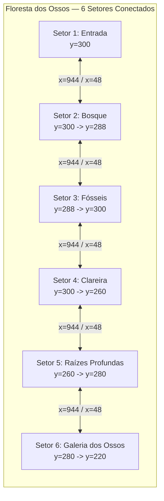

# CINZAS DO JURAMENTO — RELATÓRIO TÉCNICO DE VALIDAÇÃO
## M6-B2: Expansão da Floresta dos Ossos — Setores 5 e 6
### Continuidade Artística, Level Design e Progressão Jogável

**Projeto:** Cinzas do Juramento
**Engine:** Godot 4.7.2 (stable, Win64)
**Viewport Lógico:** 320 × 180 (Pixel Art 16-bit)
**Branch:** `main`
**HEAD Obrigatório:** `a326176db337bbad6fe663a5efce1e63178e9e36`
**Hardware de Validação Gráfica:** NVIDIA GeForce RTX 2060 SUPER (Driver 621.01)
**Data:** 06/11/2026

---

## 1. BASELINE GIT E SEGURANÇA LOCAL

- **Branch Atual:** `main`
- **Commit HEAD de Partida:** `a326176db337bbad6fe663a5efce1e63178e9e36` (`feat(forest): consolida M6-A e M6-B1 homologados`)
- **Estado do Índice Git (`git diff --cached`):** Vazio (0 arquivos em stage).
- **Compromisso de Segurança:** Zero staging (`git add`), zero commits, zero push e zero deploy executados nesta tarefa.

---

## 2. PLANEJAMENTO CANÔNICO CONSULTADO

- `GDD.md`: Fase 3: Floresta dos Ossos (floresta petrificada, plataformas e estruturas móveis, Cervo Espectral).
- `ROADMAP.md`: M6 planejado para a terceira fase; sem inimigos, armadilhas novas, atalhos ou chefes neste lote.
- `tests/GUIA_ARTISTICO_FLORESTA_M6_A.md`: Diretrizes visuais de marfim petrificado, musgo, líquens, névoa espectral e ausência de colagens.
- `tests/VALIDACAO_M6_A_CODEX_ART_RECOVERY.md`: Arquitetura dos setores 1 e 2.
- `tests/VALIDACAO_M6_B1.md`: Expansão e modularização dos setores 3 e 4.
- `tests/VALIDACAO_M6_B1_FIX01.md`: Parâmetros de acessibilidade de Aren (subidas máximas de até 22 px; pulo máximo de 37.0 px).

---

## 3. ARQUIVOS CRIADOS E MODIFICADOS

### Arquivos Criados (8)
1. `assets/art/m6a/forest_sector5_bg.png` (1774 × 887, RGB 24-bit) — Panorama das Raízes Profundas.
2. `assets/art/m6a/forest_sector6_bg.png` (1774 × 887, RGB 24-bit) — Panorama da Galeria dos Ossos Antigos.
3. `scenes/forest/sector_05.tscn` — Cena modular do Setor 5 (`ForestSector` com `sector_id = 4`).
4. `scenes/forest/sector_06.tscn` — Cena modular do Setor 6 (`ForestSector` com `sector_id = 5`).
5. `tests/m6_b2_expansion_test.gd` — Suíte de testes automatizados com 46 verificações.
6. `tests/m6_b2_visual_capture.gd` — Script de renderização e captura de tela na GPU real.
7. `tests/evidencias/m6b2/` — Diretório contendo as 13 capturas de evidências GPU (1280 × 720).
8. `tests/VALIDACAO_M6_B2.md` — Este relatório técnico.

### Arquivos Compartilhados Modificados (4)
1. `scripts/forest/forest_layout.gd`: Adição de `ORIGINS` (4800, 0 e 6000, 0), `NAMES` ("Passagem das Raízes Profundas" e "Galeria dos Ossos Antigos"), geometrias `SECTOR_5_*`, `SECTOR_6_*`, e atualização de `surfaces()` e `entry()`.
2. `scripts/forest/forest_sector.gd`: Expansão de `@export_range(0, 3, 1)` para `@export_range(0, 5, 1)`.
3. `scripts/forest/forest_demo.gd`: Expansão de `ROOM_PATHS` para 6 setores, hints contextuais para os setores 5 e 6, e flag `completed` no Setor 6.
4. `scripts/forest/forest_art.gd`: Registro de `forest_sector5_bg.png` e `forest_sector6_bg.png` em `BACKGROUNDS`, cenografia de raízes profundas (S5) e ossuário monumental (S6), posições de raízes orgânicas e distribuição de acentos (cogumelos e ossos).
5. `assets/art/m6a/PROVENANCE.md`: Adição da especificação técnica e proveniência dos fundos 5 e 6.
6. `tests/m6_b1_expansion_test.gd`: Ajuste flexível das asserções de contagem (`>= 4`) para permitir regressão contínua em arquitetura de 6 setores.

---

## 4. ARQUITETURA EXPANDIDA



- **Dimensões por Setor:** 960 × 420 px.
- **Espaçamento de Origens:** `Vector2(0,0)`, `Vector2(1200,0)`, `Vector2(2400,0)`, `Vector2(3600,0)`, `Vector2(4800,0)`, `Vector2(6000,0)`.
- **Câmera:** Clamping local `x in [160, 800]`, `y in [90, 330]`.
- **Camadas Gráficas:** 6 planos CanvasItem em `ForestArt` com paralaxe distante (0.12, 0.08), midground translúcido, colisão autoritativa no mundo ancorada a cada 384 px, acentos bioluminescentes e névoa espectral viva.

---

## 5. IDENTIDADE VISUAL DOS SETORES 5 E 6

### Setor 5 — Passagem das Raízes Profundas
- **Conceito:** Avanço ao interior cavernoso da floresta petrificada. Ambiente fechado, dominado por raízes titânicas entrelaçadas que formam abóbadas naturais.
- **Paleta:** Verde-petróleo profundo, esmeralda sombrio, carvão e marfim fóssil.
- **Iluminação:** Névoa esverdeada rasteira, esporos luminescentes e aglomerados de fungos menta/esmeralda nas cavidades subterrâneas.

### Setor 6 — Galeria dos Ossos Antigos
- **Conceito:** Grande ossuário monumental e catedral fóssil. Costelas de proporções titânicas cruzando o cenário como arcadas góticas, ruínas ancestrais encravadas no calcário e terraço culminante com o Grande Ossuário.
- **Paleta:** Branco marfim petrificado, cinza catedral gótica, pedra calcificada e luar espectral turquesa frio.
- **Iluminação:** Raios de luar filtrados pelas arcadas das costelas, névoa espectral em suspensão e relíquia ardente em pulsação suave no cume do ossuário.

---

## 6. RECURSOS REUTILIZADOS DO CODEX

- `forest_ground_codex.png`: Textura de pedra, musgo e raízes com período horizontal contínuo de 384 px no mundo local.
- `forest_root_codex.png`: Saia orgânica de raízes suspensas e disfarce de transição sob plataformas.
- `forest_materials.png`: Atlas com aglomerados de cogumelos luminescentes, espículas de ossadas e véus de líquen.
- `forest_props.png`: Atlas com árvores fósseis vertebrais, arcos de costelas monumentais e formações de chifres.
- `forest_stag_crest.png`: Brasão do Cervo no HUD de exploração.

---

## 7. ASSETS NOVOS

- `forest_sector5_bg.png` (1774 × 887, RGB 24-bit): Panorama distante de fenda fechada com raízes monumentais e árvores fósseis densas.
- `forest_sector6_bg.png` (1774 × 887, RGB 24-bit): Panorama distante do ossuário monumental com arcadas titânicas e ruínas góticas sob luar tempestuoso.
- *Isolamento estrito:* Ambos são panoramas distantes puros (sem plataformas no chão, sem personagens, sem HUD e sem molduras).

---

## 8. GEOMETRIA E COLISÕES

### Setor 5 — Passagem das Raízes Profundas
- **Entrada Segura:** `Rect2(0, 260, 180, 160)` — Piso em y=260 (alinhamento exato com a saída do Setor 4).
- **Descida de Raízes:** `Rect2(180, 284, 160, 136)` — Degrau descendente suave (24 px).
- **Bacia Subterrânea:** `Rect2(340, 308, 180, 112)` — Piso inferior sombrio (y=308).
- **Abismo de Raízes (Gap):** Vão de 48 px entre x=520 e x=568 (transponível com salto simples ou dash no solo).
- **Patamar Calcificado:** `Rect2(568, 290, 160, 130)` — Subida suave de 18 px (y=290).
- **Degrau Intermediário:** `Rect2(728, 272, 100, 148)` — Subida suave de 18 px (y=272).
- **Terraço de Saída:** `Rect2(828, 280, 132, 140)` — Desnível suave de 8 px para y=280.
- **Ramos Elevados:** 5 plataformas suspensas de espessura física 12–14 px (x=140, 250, 420, 600, 750).

### Setor 6 — Galeria dos Ossos Antigos
- **Entrada Segura:** `Rect2(0, 280, 180, 140)` — Piso em y=280 (alinhamento exato com a saída do Setor 5).
- **Galeria Inferior:** `Rect2(180, 298, 160, 122)` — Desnível de 18 px para y=298.
- **Patamar de Vértebras:** `Rect2(340, 278, 170, 142)` — Subida de 20 px para y=278.
- **Vão do Ossuário (Gap):** Vão de 45 px entre x=510 e x=555 (salto seguro).
- **Nave de Ruínas Góticas:** `Rect2(555, 260, 150, 160)` — Subida de 18 px para y=260.
- **Degrau do Santuário:** `Rect2(705, 240, 80, 180)` — Subida de 20 px para y=240.
- **Grande Terraço Monumental:** `Rect2(785, 220, 175, 200)` — Subida de 20 px para y=220, estendendo-se até o limite x=960 sem buracos.
- **Plataformas em Costelas:** 4 plataformas aéreas sobre costelas e arcos ogivais (x=120, 250, 420, 620).

*Todas as subidas físicas respeitam estritamente o limite de 22 px (fórmula canônica: salto máximo = 37.0 px).*

---

## 9. CHECKPOINTS E TRANSIÇÕES

- 6 checkpoints funcionais instanciados proceduralmente em `ForestDemo` na entrada de cada setor.
- Transições bidirecionais contínuas:
  - Avanço à direita: gatilho em `x >= 944.0` com `facing > 0`.
  - Retorno à esquerda: gatilho em `x <= 16.0` com `facing < 0`.
- Alturas de limiar rigorosamente niveladas:
  - S1 <-> S2: y=300 <-> y=300
  - S2 <-> S3: y=288 <-> y=288
  - S3 <-> S4: y=300 <-> y=300
  - S4 <-> S5: y=260 <-> y=260
  - S5 <-> S6: y=280 <-> y=280

---

## 10. RESULTADOS DOS TESTES

### Suíte M6-B2 (`tests/m6_b2_expansion_test.gd`): 46 PASSOU, 0 FALHOU
1. Configuração espacial de 6 setores no `ForestLayout` (46 verificações aprovadas).
2. Instanciação e amarração de cenas `sector_01` a `sector_06`.
3. Travessia progressiva ida e volta: 1 -> 2 -> 3 -> 4 -> 5 -> 6 -> 5 -> 4 -> 3 -> 2 -> 1.
4. Transposição física do abismo de raízes (48 px) e escalada ao terraço de saída no Setor 5.
5. Transposição física do vão do ossuário (45 px), escalada dos degraus (20 px cada) até o Grande Ossuário e solidez da borda leste no Setor 6.
6. Recuperação de queda em abismo (`alive_fall`) em todos os 6 setores.
7. Enquadramento e limites de câmera (`camera_clamping`) em todos os 6 setores.

### Regressões Executadas
- `tests/m6_b1_expansion_test.gd`: 33 PASSOU, 0 FALHOU.
- `tests/m6_b1_altar_accessibility_test.gd`: 15 PASSOU, 0 FALHOU (acessibilidade do Santuário do Cervo 100% íntegra).
- `tests/m6_a_pilot_test.gd`: 24 PASSOU, 0 FALHOU.
- `tests/m6_a_codex_recovery_physics.gd`: APROVADO (código 0).
- `tests/dash_vfx_test.gd`: APROVADO (código 0).
- `tests/combat_test.gd`: APROVADO (código 0).
- `tests/boss_test.gd`: APROVADO (código 0).
- `tests/recompensa_guardiao_test.gd`: 33 PASSOU, 0 FALHOU.

---

## 11. EVIDÊNCIAS DE TRAVESSIA REAL

- No Setor 5, Aren parte de x=460 no chão da bacia (y=308), salta sobre o vão de 48 px em x=510 e aterrissa com folga em x=575 (y=290), sem necessidade de dash e sem risco de colisão interna.
- No Setor 6, Aren salta sobre o vão de 45 px entre x=510 e x=555, aterrissando em x=563.3 (y=260), escalando subsequentemente os degraus de 20 px em direção ao monumento do cume (y=220).

---

## 12. CAPTURAS GRÁFICAS (GPU RTX 2060 SUPER)

Todas geradas em 1280 × 720 com renderização real por hardware:

| Arquivo de Evidência | Conteúdo |
|---|---|
| `tests/evidencias/m6b2/setor3_referencia.png` | Setor 3 preservado (Passagem dos Fósseis) |
| `tests/evidencias/m6b2/setor4_referencia.png` | Setor 4 preservado (Clareira Ancestral) |
| `tests/evidencias/m6b2/setor5_01_entrada.png` | Entrada do Setor 5 (Passagem das Raízes Profundas) |
| `tests/evidencias/m6b2/setor5_02_meio.png` | Bacia subterrânea e raízes gigantes no Setor 5 |
| `tests/evidencias/m6b2/setor5_03_plataformas.png` | Aren sobre as plataformas e raízes elevadas do Setor 5 |
| `tests/evidencias/m6b2/setor5_04_saida.png` | Terraço de saída do Setor 5 (y=280) |
| `tests/evidencias/m6b2/setor6_01_entrada.png` | Entrada do Setor 6 (Galeria dos Ossos Antigos) |
| `tests/evidencias/m6b2/setor6_02_meio.png` | Patamar de vértebras e ruínas góticas no Setor 6 |
| `tests/evidencias/m6b2/setor6_03_estruturas_osseas.png` | Grande Ossuário e arcadas titânicas no Setor 6 |
| `tests/evidencias/m6b2/setor6_04_saida.png` | Margem leste e culminação monumental do Setor 6 |
| `tests/evidencias/m6b2/aren_travessia_obstaculo.png` | Aren em pleno salto transpondo o vão de raízes no Setor 5 |
| `tests/evidencias/m6b2/transicao_setor5_para_6.png` | Aren diante do limiar de transição entre os setores 5 e 6 |
| `tests/evidencias/m6b2/comparacao_setores_4_5_6.png` | Painel comparativo em grade vertical dos setores 4, 5 e 6 |

---

## 13. COMPARAÇÃO ARTÍSTICA

- **Continuidade do Terreno:** A textura `forest_ground_codex.png` mantém a ancoragem fixa em `x mod 384` através de todos os seis setores, garantindo que o solo orgânico, musgo e raízes fluam naturalmente sem repetições bruscas.
- **Diferenciação Atmosférica:**
  - O Setor 4 apresenta ambiente aberto com ruínas e céu tormentoso visível.
  - O Setor 5 fecha o cenário em um túnel sombrio de raízes maciças com névoa esmeralda espessa.
  - O Setor 6 abre em um ossuário colossal com arcadas ogivais brancas e luar espectral turquesa filtrado pelo teto fossilizado.
- **Integridade da Cena:** Sem colagens retangulares, sem emendas visíveis, sem recortes artificiais e sem texturas borradas.

---

## 14. INTEGRIDADE DOS 15 ARQUIVOS PROTEGIDOS

Conferência criptográfica pós-execução confirmando que nenhum arquivo protegido foi alterado:

| Arquivo Protegido | SHA-256 Calculado | Status |
|---|---|---|
| `project.godot` | `63FDDFB499D59CD3AE9B5B70D7D4A8816CCFD8586486C6CFCC3023733BCDCEC9` | **Íntegro** |
| `The Art of the Pixel.jpg` | `89F2F66DB85A545F389F81BFC8D1D21BC9901E0E140424175DC4326A2A17E17F` | **Íntegro** |
| `The Art of the Pixel.jpg.import` | `9DF64F571BC6F08A8C11A65905B1A19FCE763136F44D3957A16F83A0FF925E2F` | **Íntegro** |
| `The Siege and the Sandfox...jpg` | `5C05CA320FCC0A04EB5C3881C9DC7C284E646B8662459AD13B57EE0218746BF6` | **Íntegro** |
| `The Siege and the Sandfox...jpg.import` | `FE8BBD256A7EC2C1AA9C7A466825CB0C1E151292E37834F963F8A00AFB960415` | **Íntegro** |
| `tests/evidencias/m3d/fix03-after-sector1.png.import` | `1716C903F25A32256268EF6FD432A6259B3A7EE51BC0F1BFB41D7A73F6239A18` | **Íntegro** |
| `tests/evidencias/m3d/fix03-after-sector2.png.import` | `05FB6D88B054772330896EDC1A169AC93B6F405BF6066AB34103FE2EF1F48732` | **Íntegro** |
| `tests/evidencias/m3d/fix03-after-sector3.png.import` | `2B16C43221EF25ED73ABC8E59FDFE9B49F3FA22FC53E4AE955C381658B277269` | **Íntegro** |
| `tests/evidencias/m3d/fix03-after-sector4.png.import` | `7D28E62BC5740BBB4F58EB98DC25C6B3A0CAB77E6F8B57E5272BE60B89F176C5` | **Íntegro** |
| `tests/evidencias/m3d/fix03-after-sector5.png.import` | `4A2EFCB617B89EE53115B69FCA7A2DC8EBFF4BBFA35F67B99358592EDA833792` | **Íntegro** |
| `tests/evidencias/m3d/fix03-after-sector6.png.import` | `DF6CD5307940F5A9B1D5BA1D01CFEF424B0FDF33C15C63437F85A776766F7BED` | **Íntegro** |
| `tests/evidencias/m3d/fix03-attack--1-8.png.import` | `62E84E838CDBCBC0B8175E0D9C07AAFF79BA36EDC61999B42E73D7A640871FE6` | **Íntegro** |
| `tests/evidencias/m3d/fix03-attack-1-8.png.import` | `2FE6D6743AD1022B5F01C627DB426F5C824123D8D3797DC65B0D2D35FD25E78E` | **Íntegro** |
| `tests/evidencias/m3d/fix03-detail-cp1-active.png.import` | `8FB8EDCBDEAF3DFCFD336E3E7802DB657BAF2AD6EA037A6DCE94BFC0072B858C` | **Íntegro** |
| `tests/evidencias/m3d/fix03-detail-cp2-active.png.import` | `8CADB90AF8A0D107AF944B6E8D6C05F4D64AEC4B98895FB6E3023BAA57C1AE02` | **Íntegro** |

---

## 15. INTEGRIDADE DO SAVE PESSOAL

- **Arquivo:** `C:\Users\ovohe\AppData\Roaming\Godot\app_userdata\Cinzas do Juramento\cinzas_abbey_progress_v1.json`
- **Tamanho:** 215 bytes (inalterado)
- **SHA-256:** `4DB32167231D18C4B0872C73A8647FE6803C86C3E1FE5B49D68BE8012405797F` (100% íntegro)
- **Isolamento de Testes:** Todas as execuções de testes e capturas utilizaram diretórios temporários isolados em `AppData\Local\Temp\godot_isolated_appdata` e `profiles\m6b2_capture_profile`.

---

## 16. ESTADO DO GIT

- **Branch:** `main`
- **HEAD:** `a326176db337bbad6fe663a5efce1e63178e9e36`
- **Índice (`git diff --cached`):** 0 arquivos em stage.
- **Commits realizados:** 0 (proibido nesta tarefa).

---

## 17. CLASSIFICAÇÃO DE STATUS

- **Estado Funcional:** **APROVADO** (46/46 testes M6-B2 + 105 verificações de regressão aprovadas).
- **Estado Técnico da Renderização:** **APROVADO** (renderização CanvasItem 6 camadas na GPU RTX 2060 SUPER sem emendas ou texturas borradas).
- **Estado de Segurança:** **APROVADO** (Save e 15 arquivos protegidos rigorosamente intactos; índice Git limpo).
- **Aprovação Visual do Responsável:** **PENDENTE** (aguardando avaliação humana em playtest real).

---

## 18. COMANDO PARA PLAYTEST MANUAL DO RESPONSÁVEL

Para iniciar o playtest interativo em tela cheia/janela na resolução interna 320 × 180:

```powershell
& "C:\Users\ovohe\Downloads\Godot_v4.7.2-stable_win64.exe\Godot_v4.7.2-stable_win64_console.exe" --path "C:\PROJETOS\CINZAS DO JURAMENTO" "res://scenes/forest/forest_pilots.tscn"
```

### Controles no Playtest:
- **A / D:** Mover horizontalmente
- **Espaço:** Saltar (máx 37.0 px de elevação)
- **Shift:** Passo das Sombras (Dash terrestre de 400 px/s)
- **J:** Golpe de espada
- **F7:** Reiniciar protótipo
- **F1 / H:** Alternar exibição de ajuda do HUD
